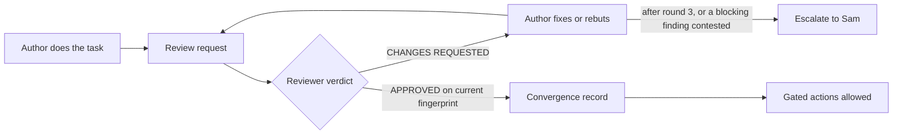

# Agent review policy

v1.0, 2026-10-28. Owner: Sam Zhou. Status: in force since 2026-10-28 by Sam's decision to make this project review-gated on the framework of the Positron Conversion DIO project; ported from that project's policy v1.1 (commit 0fe2a32) with the project-specific changes listed in section 10. The port is task P0.1 (`reviews/2026-10-28-p0.1-bootstrap.md`). Changes to this file or to `CLAUDE.md` need Sam's explicit approval (section 10).

This project is review-controlled. No work produced by an AI agent is accepted until a second, independent agent has reviewed it and issued an explicit written approval. If the reviewer requests changes, the author corrects and resubmits, and the two repeat the loop until they converge. The reviewer is by default an agent from a different model family: OpenAI Codex when the author is Claude Code, and the reverse. `CLAUDE.md` carries the binding summary; this file is the full protocol.

## 1. The loop in short

1. The author finishes the task and writes a review request (section 7.1) into a record file under `reviews/`.
2. The author starts an independent reviewer from a different model family: by default Codex, run non-interactively in a read-only sandbox (section 8.1), with the prompt in section 8.2. A fresh Claude subagent is the fallback only when Codex is unavailable (section 8.3).
3. The reviewer inspects the work itself, verifies it independently, and returns a verdict (section 7.2) that goes into the record verbatim: `APPROVED`, or `CHANGES REQUESTED` with numbered findings.
4. On `CHANGES REQUESTED`, the author fixes or rebuts every finding in a response (section 7.3), recomputes the revision fingerprint, and resubmits to the same reviewer thread.
5. Steps 3 and 4 repeat until the reviewer issues `APPROVED` on the current fingerprint with no blocking finding open or contested, and every non-blocking finding fixed, deferred by agreement, or recorded as a disagreement. That is convergence (section 4.1).
6. Only after convergence may the author do a gated action (section 4.3): report the result as final, commit, submit to Kaggle, or build on the work.
7. After 3 rounds without convergence, or as soon as a blocking finding is contested, the author stops and escalates to Sam (section 5). A cap, a timeout, or silence is never approval.



## 2. Definitions

| Term | Meaning |
|---|---|
| Task | A unit of work assigned by Sam, or derived from an assignment. The unit of review is the task as assigned. |
| Work product | Anything a task produces that persists or will be relied on: file changes (code, scripts, configs, notes, documents), produced data or plots, numbers, derived quantities, conclusions, recommendations, and state-changing actions (Kaggle submission, deletion, installation, a post on Piazza, an upload to Gradescope). |
| Author | The agent that produced the work product. |
| Reviewer | A separate agent, by default from a different model family than the author, that evaluates it. |
| Revision | The exact state of the work product at one moment, identified by a fingerprint (section 4.2). |
| Round | One review request followed by one verdict. The author's response to findings opens the next round's request. |
| Finding | One specific problem the reviewer identified, with a severity (section 6.2). |
| Contested finding | A finding the author has rebutted and the reviewer has upheld. |
| Approval | A verdict of `APPROVED` bound to one revision fingerprint. |
| Convergence | Approval on the current revision with no blocking finding open or contested, and every non-blocking finding fixed, deferred by agreement, or recorded as a disagreement (section 4.1). |
| Gated action | An action forbidden before convergence (section 4.3). |

## 3. Scope

### 3.1 Requires review

Every work product, regardless of size. A one-line change is not exempt. A number quoted in chat that Sam will act on is a work product.

### 3.2 Does not require review

- Read-only investigation: reading files, searching, running non-mutating commands.
- Explaining existing material in conversation when it produces no new number, derived result, recommendation, or file.
- The review records in `reviews/`. Writing them is part of the process.
- Scratch files in an agent's own scratchpad that are not part of the project.

When in doubt, review.

### 3.3 Waivers

Only Sam can waive review, explicitly and for a named task. Agents never infer a waiver from urgency, triviality, or silence. The waiver is recorded in `reviews/` with Sam's wording.

## 4. Approval and convergence

### 4.1 Convergence

The loop has converged when all four hold:

1. The reviewer issued `VERDICT: APPROVED` for the current revision fingerprint.
2. No blocking finding is open or contested.
3. Every non-blocking finding is fixed, deferred with both agents' agreement recorded, or recorded as a disagreement under section 5.
4. The author recorded that the delivered fingerprint equals the approved fingerprint.

### 4.2 Revision fingerprints

Every review request and every verdict names the revision it refers to.

| Situation | Fingerprint |
|---|---|
| Files in the project (the normal case) | From the project root: `tools/fingerprint.py`, which prints the hash (`-m` prints the manifest as well). With git it covers every tracked and untracked file that is not ignored; without git, every file under the project except `.git/` and `__pycache__/`; an explicit file list may be given instead. Review records `reviews/YYYY-MM-DD-*.md` are always excluded, so appending a request or a verdict never changes the fingerprint. Each file contributes its type (regular file, symlink, or tracked file deleted from the working tree), its executable bit, and the sha256 of its content or link target; the manifest is sorted bytewise and hashed. Any error aborts with no fingerprint: a directory that cannot be listed, metadata or content that cannot be read, a missing file, a directory or special file, or a file name containing control characters. Only a genuinely absent path counts as absent. Record `git status --short` alongside when git is in use. |
| Git, committed and clean | `git rev-parse HEAD` is acceptable when `git status --short` prints nothing; otherwise use the tool. |
| Produced data or plots | `sha256sum` of each output file, or include them in the tool's file list |
| Kaggle submission | The prediction file is a project file and part of the tool's file set; the request names it, its `sha256sum`, and the submission description to be entered on Kaggle. Reviewed before it is uploaded. |
| Result or recommendation delivered only in chat | The exact text is pasted into the request and fingerprinted with `sha256sum` |
| Intended state-changing action (Kaggle submission, deletion, installation, a post on Piazza, an upload to Gradescope) | The exact command, pasted into the request and fingerprinted as text. Reviewed before it is executed. |

An approval applies only to the fingerprint it names.

### 4.3 Gated actions

Forbidden before convergence:

- Reporting a result, number, or conclusion to Sam as final. Interim status is allowed if labelled "unreviewed".
- Committing or pushing.
- Submitting predictions to Kaggle, posting on Piazza, or uploading to Gradescope.
- Modifying shared or production resources; deleting data.
- Starting a dependent task that builds on the unreviewed work.

### 4.4 Invalidation

Any change to the work product after approval, however small, invalidates the approval. A new round is required. It may be short, but it must end in a fresh `APPROVED` on the new fingerprint.

## 5. Escalation and human authority

- Round cap: after 3 rounds without convergence, stop. Write an escalation summary (section 7.4) into the record and give it to Sam. Sam decides: continue, override, or take over. If Sam says continue, a new count of 3 rounds begins unless Sam sets another number. The cap is a circuit breaker, not an approval.
- Contested findings: a finding the author rebuts and the reviewer upholds is contested. A contested blocking finding prevents convergence and goes to Sam at once, before any round cap. A contested non-blocking finding is recorded as a disagreement in the verdict's Notes and does not prevent approval. Severity is the reviewer's call: if the reviewer says blocking, it is blocking.
- Sam's authority: Sam may approve, reject, waive, or override anything. Sam's explicit approval of a revision counts as reviewer approval for that revision. Record it verbatim.

## 6. Roles and obligations

### 6.1 Author

- Do the task as assigned, no more and no less. Do not split a task to keep the pieces "too small to review".
- Verify your own work before requesting review. Put the commands and their key output in the request.
- State known limitations and open questions in the request.
- Never self-approve. Never paraphrase a verdict; quote it. Never edit after approval without a new round.
- Address every finding: fix it, or rebut it in writing with reasons. Silence on a finding is non-compliance.
- Start the reviewer with the neutral prompt in section 8.2. Do not ask it to confirm that the work is correct.

### 6.2 Reviewer

- Independence: an agent from a different model family than the author, in its own context. Default when the author is Claude Code: OpenAI Codex CLI, run non-interactively in a read-only sandbox by `tools/codex_review.sh`. Default when the author is Codex: Claude Code in non-interactive read-only mode (section 8.4). Fallback, only when the other family is unavailable and with the reason recorded: a fresh Claude general-purpose subagent started with the Agent tool. Never a fork of the author, never the author's own session. Use the strongest available model of the reviewing family.
- Inspect the artifact, not the summary. Read the actual files, diffs, and outputs. The review request is a map, not evidence.
- Verify independently. Run the tests, re-execute scripts, recompute at least one key number, check units and conventions against the cited references.
- Do not modify the work product. Report; the author fixes. A Codex reviewer runs in a read-only sandbox and returns the verdict as its final message; the author appends it to the record verbatim. A Claude subagent reviewer appends its verdict to the record itself and writes no other project file.
- Return a structured verdict (section 7.2): exactly one of `APPROVED` or `CHANGES REQUESTED`, bound to the fingerprint, as the last line, with notes before it. Each finding has a severity, a location, the problem, and what would resolve it. The reviewer script rejects any other shape (section 8.1).
- No rubber stamps. An `APPROVED` lists what was checked and how. A verdict without verification evidence is invalid and the author must request a new one.

Severity:

| Severity | Covers |
|---|---|
| Blocking | Wrong result, mathematics, or statistics; information leaking from validation or test data into training; departs from the task specification; unsafe or destructive; unverified claim; not reproducible; violates project rules or course rules. |
| Non-blocking | Clarity, style, naming, minor inefficiency, suggestions. |

### 6.3 Reviewer checklist

1. Specification: does the work do exactly what the task asked? Anything missing or extra?
2. Correctness: logic, edge cases, error handling. Machine-learning conventions: no leakage across validation folds (rows of the same track stay in one fold), the same preprocessing for training and test data, the target encoded as Kaggle scores it, probabilities where the metric rewards them. Statistical treatment.
3. Numbers: recompute at least one key quantity independently. Cross-check against references where they exist.
4. Reproducibility: inputs, versions, seeds, configurations, and commands are recorded. A re-run reproduces the stated outputs.
5. Evidence: the claimed tests and checks exist and pass. Run them.
6. Safety: no destructive or irreversible operations, no hard-coded paths that work in only one place, no credentials.
7. Documentation: the change is explained where a future reader will look.
8. Process: this policy was followed. Fingerprint present, scope not split, no edits after approval.
9. Course rules (`CLAUDE.md`): only the provided data, no existing code written for this dataset, every use of an LLM recorded for the report.

## 7. Records and templates

One record file per task: `reviews/YYYY-MM-DD-<slug>.md`, appended round by round. Verdicts verbatim, never paraphrased. Escalation summaries (section 7.4) and waivers (section 7.6) go into the same file. `reviews/_TEMPLATE.md` holds the skeleton.

### 7.1 Review request (author)

```markdown
## Round N: review request
Task: <what was asked, quoted or closely paraphrased>
Author: <model, session>
Revision: <fingerprint> (<how computed>)
Files changed or created: <list>
Intended action: <exact command to be executed after approval, or none>
What was done: <short description>
How it was verified: <commands run and key output>
Known limitations and open questions: <list, or "none">
Response to previous findings: <section 7.3, rounds 2 and later>
```

### 7.2 Verdict (reviewer)

```markdown
## Round N: verdict
Reviewer: <model, agent>
Revision reviewed: <fingerprint>
What I checked and how: <list, with commands run and their results>
Findings:
  F1 [blocking | non-blocking] <file:line or location>. <problem>. <what would resolve it>
  F2 ...
Notes: <deferred non-blocking items, recorded disagreements>
VERDICT: APPROVED | CHANGES REQUESTED
```

### 7.3 Response to findings (author, rounds 2 and later)

```markdown
F1: FIXED. <what changed>
F2: REBUTTED. <reasons>. Reviewer decision requested.
F3: DEFERRED. <why>. Reviewer agreement requested.
```

### 7.4 Escalation summary (author, to Sam)

```markdown
## Escalation
Task: ...
Rounds completed: <N>
Unresolved: <finding; author position; reviewer position>
Decision needed from Sam: ...
```

### 7.5 Convergence record (author)

```markdown
## Convergence
Approved revision: <fingerprint>
Delivered revision: <fingerprint, must match>
Human decisions: <waivers or overrides, verbatim, or "none">
```

### 7.6 Waiver (author, quoting Sam)

```markdown
## Waiver
Task: ...
Sam's wording, verbatim: "..."
Date: YYYY-MM-DD
```

## 8. Running the loop

### 8.1 Default mode: Claude Code is the author, Codex is the reviewer

1. Do the work in the Claude Code session.
2. Compute the fingerprint with `tools/fingerprint.py` from the project root. Write the review request into the record file.
3. Run the reviewer: `tools/codex_review.sh <record> <round> <fingerprint>`. The script runs `codex exec` non-interactively with the project as working root, a read-only sandbox, and the reviewer model pinned to `gpt-6-astra` at reasoning effort `xhigh` (overridable through `CODEX_MODEL` and `CODEX_EFFORT`), so the reviewer can read everything and run non-writing checks, cannot change a file, and does not follow changes to the interactive Codex default. It accepts the output only if its first line is exactly the round heading, it has exactly one `Revision reviewed:` line whose value is the fingerprint under review, and exactly one well-formed `VERDICT` line as its last line; otherwise it appends nothing and keeps the output for diagnosis (`tools/codex_review.sh check <file> <round> <fingerprint>` runs the same test on any file). An accepted verdict is appended to the record verbatim, followed by a line with the CLI version, model, effort, sandbox, and thread id. The reviewer's raw output, event log and stderr are kept under `REVIEW_LOG_DIR` (default `.review_logs/` in the project root, ignored by git, with `TMPDIR` as the fallback when that directory cannot be created), so the executed-command evidence outlives the session; the appended run line names the log.
4. On `CHANGES REQUESTED`: fix, write the response, recompute the fingerprint, and resubmit to the same reviewer thread: `tools/codex_review.sh <record> <round> <fingerprint> <thread id>`. The reviewer re-verifies from the artifact, not from the response.
5. On `APPROVED`: confirm fingerprint equality, write the convergence record, then proceed.

When a review has to run code that writes files, run the script with `CODEX_SANDBOX=workspace-write` and recompute the fingerprint afterwards. It must equal the one under review; otherwise the verdict is void and the round is repeated.

For a final number that goes into the report or the Colab notebook, and for a submission proposed as one of the two final selections, add one fresh-eyes pass in a new reviewer thread after convergence. It is a normal round in the same record: its verdict binds like any other, and convergence must be re-established, on the same fingerprint if nothing changed.

If the reviewer thread cannot be continued (thread not resumable, session gone, or the reviewer changed by Sam's decision), the author starts a new reviewer with the section 8.2 prompt. That prompt tells the reviewer to read the entire record, and every open finding from earlier rounds stands until the new reviewer rules on it. The round count continues.

The prompt's instruction to read `AGENTS.md` (or `CLAUDE.md`) is load-bearing: a Codex run or a subagent does not necessarily have the project rules in context. Never drop it. The author may add neutral task-specific pointers (areas to examine, files that matter) through the `REVIEW_POINTERS` environment variable of the script, but nothing that presupposes correctness.

Requirements, all verified on Sam's Mac on 2026-10-28: Codex CLI 0.160 or later (0.160.0 installed), logged in, `CODEX_HOME` set (the script defaults it to `~/.codex`, where the configuration and session logs live), `python3` for `tools/fingerprint.py` (3.9.6 at `/usr/bin/python3`). `AGENTS.md` is a link to `CLAUDE.md`, so Codex reads the same rules as Claude Code.

### 8.2 Reviewer prompt

The script builds this prompt. The fallback of section 8.3 uses the same text with the two bracketed changes.

```text
You are the independent reviewer for a task in the CS 155 Miniproject 1 project. Read AGENTS.md [fallback: CLAUDE.md] and doc/review_policy.md sections 6 and 7 first.

Your job is to find what is wrong, missing, unverified, or out of scope. You are not asked to confirm that the work is correct.

Review record: reviews/<file>.md. Read the "Round N: review request" there; it names the task, the files, and how the author verified the work. If this is not round 1, read the entire record: every finding from earlier rounds stands until you rule on it, fixed or upheld.
Revision under review: <fingerprint>. Recompute it with the command given in the request; if it differs, say so in the verdict.

Inspect the actual files and outputs, not only the request. Run the verification yourself where the sandbox allows: tests, scripts, recomputation. Do not modify any project file [fallback: except appending your verdict to the review record].

Your final message must be exactly a verdict in the format of section 7.2 of the policy: it starts with the line "## Round N: verdict", names the revision fingerprint, puts Notes before the verdict line, and its last line is exactly "VERDICT: APPROVED" or "VERDICT: CHANGES REQUESTED", with nothing after it. Each finding needs a severity (blocking or non-blocking), a location (file and line or section), the problem, and what would resolve it. An APPROVED must list what you checked and how.
```

### 8.3 Fallback: a Claude subagent as reviewer

Only when Codex is unavailable, and the record says why. Start the reviewer with the Agent tool, `subagent_type: general-purpose`, fresh context, never `fork`, with the prompt of section 8.2 and its bracketed changes. The reviewer appends its verdict to the record itself. For later rounds continue the same reviewer with SendMessage so it keeps its own findings in context.

### 8.4 Reverse direction: Codex is the author, Claude Code is the reviewer

The same loop with the roles swapped. Codex writes the review request, then runs Claude Code non-interactively and read-only, `claude -p --permission-mode plan "<prompt of section 8.2>"`, and appends the printed verdict to the record verbatim.

### 8.5 Alternative mode: neutral orchestrator

For larger tasks the Claude Code session acts only as orchestrator. One subagent authors, Codex reviews, and the orchestrator relays the structured records and edits nothing itself. The same rules apply.

### 8.6 Optional hardening

- Version control. The project is a git repository from P0.1 on, so fingerprints and diffs are trivial and Codex's built-in `codex exec review` is available.
- Hooks. A Claude Code `PreToolUse` hook can block `git commit`, `git push`, and Kaggle submission unless a convergence record exists for the current fingerprint. A `Stop` hook can refuse to end a turn with unreviewed changes.
- Workflows. The write, review, fix loop can be scripted deterministically with Claude Code's Workflow tool. Sam opts in per task by saying "use a workflow".

## 9. Anti-patterns

Each of these is a policy violation:

- The reviewer is a fork of the author, or the author reviews its own work.
- Reviewing the author's summary instead of the artifact.
- `APPROVED` without verification evidence.
- The author reports "reviewer approved" without the verbatim verdict and fingerprint.
- Edits after approval without a new round.
- Splitting a task to keep each piece below review.
- Leading reviewer prompts such as "confirm this is correct".
- Treating the round cap, a timeout, or silence as approval.
- The reviewer fixing the work directly.
- Using the same-family fallback reviewer while Codex is available, or without recording why.

## 10. Canonical location and change control

- Canonical: `doc/review_policy.md` and `CLAUDE.md` in this project. Any copy elsewhere is informational; the project copy wins.
- Changes to either file need Sam's explicit approval. Agents do not change them on their own initiative.
- History: v0.1, 2026-09-23, initial policy. v0.2, 2026-09-23, Codex (a different model family) as the default reviewer, `AGENTS.md` linked to `CLAUDE.md`, `tools/codex_review.sh` added. v0.3, 2026-09-23, `tools/fingerprint.py` (manifest fingerprint that excludes review records and covers file type, executable bit and link targets), strict verdict acceptance in the reviewer script, reviewer model pinned to gpt-6-astra at max effort, Notes before the verdict line. v0.4, 2026-09-23, fingerprint tool aborts on enumeration and metadata errors and on control characters in file names; verdict binding through the `Revision reviewed:` field and the exact heading. v1.0, 2026-09-24 (Positron Conversion DIO): ported from `Incoherent_Conversion_Search/doc/review_policy.md` v0.4 on Sam's instruction, with these changes and nothing else: the status line; the project name in the section 8.2 prompt and in `tools/codex_review.sh`; the section 4.2 row for products outside the repository; the reviewer log location and the `CODEX_HOME` default in section 8.1 and the script; the section 8.6 version-control bullet; this history entry. v1.1, 2026-09-25, with Sam's approval (`reviews/2026-09-25-reviewer-model-switch.md`): the reviewer model pinned to gpt-6-sol at reasoning effort xhigh, in place of gpt-6-astra at max, in section 8.1, `CLAUDE.md` rule 2 and `tools/codex_review.sh`; nothing else. This project: v1.0, 2026-10-28: ported from `Positron_Conversion_DIO/doc/review_policy.md` v1.1 (commit 0fe2a32) on Sam's instruction, with these changes and nothing else: the status line; Kaggle submission, Piazza posts and Gradescope uploads in place of job submission in sections 1, 2, 4.2, 4.3 and 8.6; the section 4.2 row for products outside the repository replaced by a row for Kaggle submissions; the blocking severity and checklist item 2 of section 6 for machine learning in place of physics; checklist item 9 for the course rules; the reviewer model pinned to gpt-6-astra at reasoning effort xhigh, the reviewer log location, the fresh-eyes pass and the requirements in section 8.1; the project name in the section 8.2 prompt and in `tools/codex_review.sh`; the `CODEX_HOME` and log defaults in the script; this history entry.
